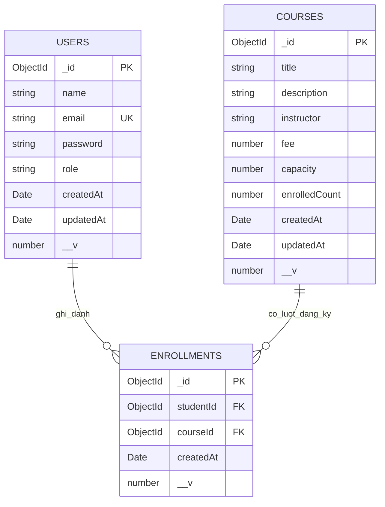

# Sơ đồ ERD hệ thống quản lý khóa học

Sơ đồ dưới đây được đối chiếu với các Mongoose model `UserModel`, `CourseModel` và `EnrollmentModel`.

## Trường và ràng buộc theo model

- **USERS:** `name`, `email`, `password`, `role` là String và bắt buộc. `email` được trim, chuyển chữ thường và có unique index. `password` không được select mặc định. `role` chỉ nhận `ADMIN` hoặc `STUDENT`, mặc định là `STUDENT`.
- **COURSES:** `title`, `description`, `instructor` là String và bắt buộc; `fee` là Number không âm; `capacity` là số nguyên tối thiểu 1; `enrolledCount` là số nguyên không âm, mặc định 0.
- **ENROLLMENTS:** `studentId` và `courseId` là ObjectId bắt buộc; lần lượt tham chiếu đến `User` và `Course`.
- Cả ba model có MongoDB `_id` kiểu ObjectId và Mongoose version key `__v` kiểu Number.
- `USERS` và `COURSES` bật timestamps đầy đủ (`createdAt`, `updatedAt`). `ENROLLMENTS` chỉ bật `createdAt`, không tạo `updatedAt`.
- Hai quan hệ đều là **1-N**: một User có thể có nhiều Enrollment; một Course có thể có nhiều Enrollment. Mỗi Enrollment tham chiếu đến đúng một User và một Course.
- `ENROLLMENTS` có unique compound index `{ studentId: 1, courseId: 1 }` để một học viên không ghi danh cùng khóa học nhiều lần; đồng thời có index riêng `{ courseId: 1 }` để tra cứu danh sách ghi danh theo khóa.
- Ngoài `_id`, `COURSES` không khai báo unique index riêng trong model.
